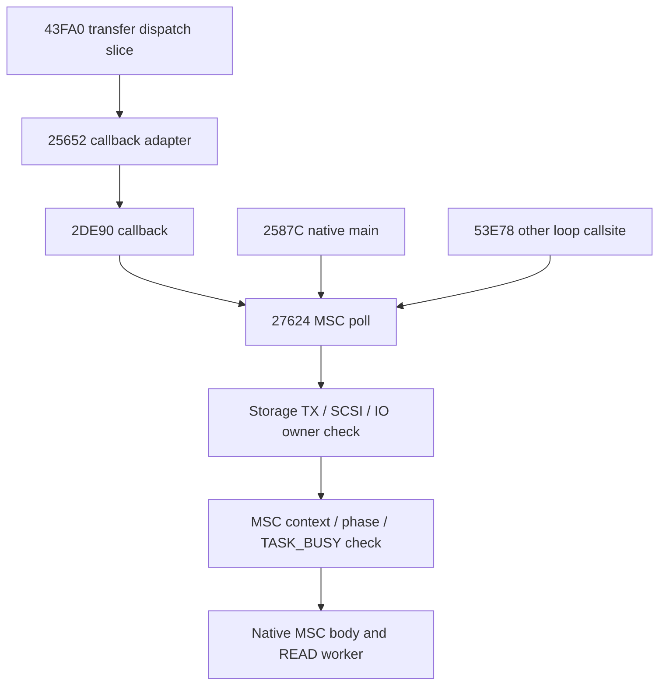

> Güncel29 Ekim (uzun sample loop):native53E24/53E8C128 yuva döngüsü,
> dosya/flash/UI/allocator RAM sınırlarıyla10 yeni yerel/10 paket testte PASS.
> Aktif USB okuyucu,worker reentry,semaphore,reset/suspend ve double-buffer
> denetlendi. File-task ömrü/gerçek UI ve main retry/power erişimi açık.
> Önceki101 kaynak/firmware aynı;510 discovery,tam510 bu oturumda koşulmadı.
> Production Off/Stop FAIL,M7 NO-GO. STATUS ve MIDI-USB-LONG-LOOP-5706.md güncel.

---

# Ek MSC poll çağrıları — 5706

Yalnız sentetik RAM/MMIO emülasyonudur. Firmware koduna yeni değişiklik yok;
production builder'a eklenmedi. Fiziksel MIDI/USB cihazı veya API'si kullanılmadı.

## Zincir ve sınır

273A8→2DE9A,8B callback nesnesine vtable69628/function2DE91 koyar.43B2C
callback'i view+48'e bağlar.43FA0 slice'i vtable[0]=25653'ü çağırır;native25652
adapter nesne+4 function'ına gider.2DE90,27624'ü çağırıp sonucundan bağımsız0
döner.0'ı ilerleme veya tamamlanma sonucu diye yorumlamak yanlıştır.

View/callback binding'i sentetiktir;dispatch slice/adapter/callback/native
poll/READ worker/HAL/IRQ kodu gerçektir. Tam43E1C transfer handler'ı ve gerçek
nesne oluşturma/lifetime/RTOS/UI erişimi çalıştırılmadı.53E78 yalnız tek BL
kenarında testlidir;çevresindeki53E24 uzun loop henüz kanıtlanmış değildir.

## Doğrulama

13 senaryo:iki modda callback READ/data/CSW;IRQ/masked giriş;aktif worker/data
TX;recursive poll;poll kabulü ile native gövde arasına suspend;worker içi
suspend/reset;gerçek completion IRQ içi callback;asleep MMIO/ledger korunması;
factory içi callback;callback-only ilerleme negatifi;diğer53E78 BL kenarı.

Native continuation2762A sayılır;enjeksiyonun2EF5A readiness girişini yeniden
ziyaret etmesi ikinci poll sayılmaz. Read/cancel/buffer/ticket/byte stream ve
canary'ler test edilir. IRQ/worker ownership bitmeden cancel/service ilerlemez.
13 yeni test ve paketlenmiş aday overlay'inde13 test PASS. Önceki97 kaynak,
474 tam test+13 factory sonucu ve firmware/codegen pin'leri korunur.500 toplam
discovery'dir;bu oturumda tüm500 koşulmadı. Kod audit'i SP0/BL8 ve mevcut3
carry masked commit/max30 komut için PASS;tam stack veya IRQ timing kanıtı değil.

Callback yalnız MSC poll eder.32 callback-only tur,deferred MIDI yanıtını ve
uyku isteğini ilerletmez;coordinated native main geri geldiğinde tamamlanır.
Uzun handler içindeki main erişimi/MIDI backpressure problemi çözülmüş
sayılmaz. Bu nedenle yeni bir full-service hook'u körlemesine eklenmedi.

## Kalan iş

53E24 uzun loop'un storage/vtable owner'ı ve128 iterasyonu sonraki hedeftir.
Tam43E1C/Packs/proje akışı ve callback ömrü,RTOS/boot/2712B checked RAM-init,
gerçek PHY/clock/ACK/flash/UART timing,accepted TX/raw ALT/partial parser/held
input/fault recovery,storage partial-read/live-pattern alias,DIN input ve
production integration açıktır. Üretim Note Off/Stop kaybı sürer;M7 NO-GO.

logs/usb-poll-callers-20261029 altında trace/probe gözlemleri,source diff,
SHA/MPEG-2 CRC/vector/range manifest vardır. Initial emulator snapshot önceki
staging/factory ile aynıdır;test instrumentation'ı flashable yeni firmware değildir.
